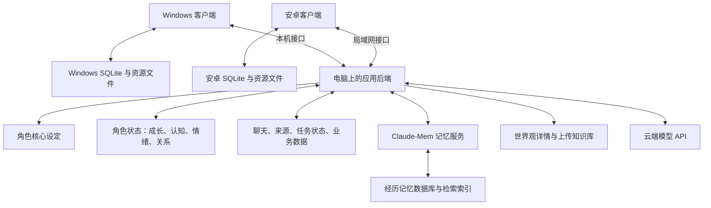
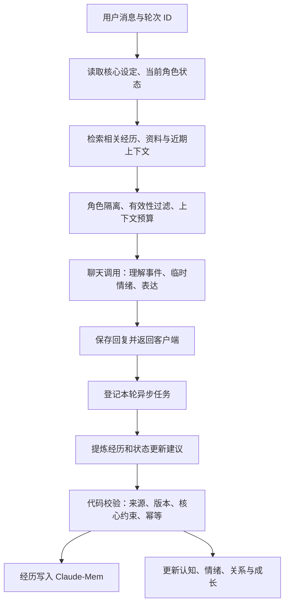

# 总体架构与数据流

[返回入口](../README.md)

## 当前事实

- 现有项目使用 React 19、TypeScript、Tauri 2、Rust，主要面向 Windows。
- 已有悬浮头像与计划面板、任务、卡牌、道具、史莱姆、主题及模型调用。
- 原生数据层将整体状态保存为 state.json，图片另存；浏览器预览使用浏览器存储。
- 现有 isDesktop 实际使用 isTauri()，需要区分“原生运行环境”和“Windows 桌面能力”。
- 现有启动逻辑依赖双桌面窗口；提醒使用 Windows schtasks。安卓不能直接照搬。
- 尚未实施 SQLite／PostgreSQL 迁移、角色系统或 Claude-Mem 接入。

## 目标架构

Windows 和平板的本地存储各自独立。电脑中的 PostgreSQL 是同步汇总存储；平板不连接 PostgreSQL 端口，通过应用接口访问。

应用状态与 Claude-Mem 数据建议共用 PostgreSQL 实例、分数据库与账号。角色状态不能仅靠向量搜索临时拼出，也不由 Claude-Mem 自动决定。

## 一轮交流的数据流

后台维护单独负责经历淡化、自然遗忘及按时间计算情绪变化。用户不直接删除记忆，记忆不跨角色共享。图中“纠正”指新信息推动系统修正判断，不代表用户可直接编辑状态数据库。

## 来源图

用户提供的两张图已存入 assets，作为设计参考，不作为已落地证明。

## 待定

- 总图中不展开每个数据库表；表结构在模块接口稳定后形成单独设计。
- 多设备同时与同一角色聊天时的前台生成顺序，见 [C-03](open-questions.md)。
- Claude-Mem 固定版本的服务端功能与依赖，需要实际接入验证；历史检查不等同兼容性测试。
